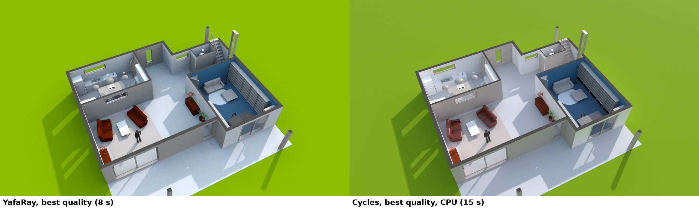
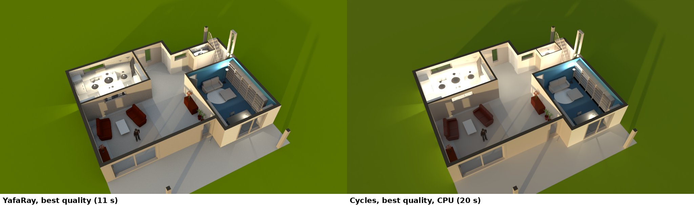
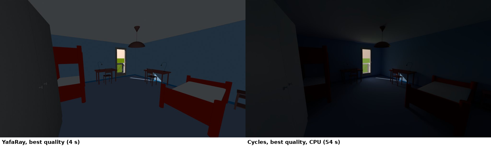
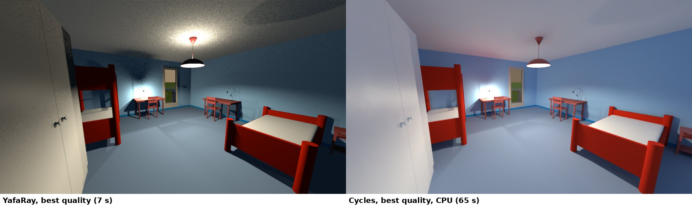
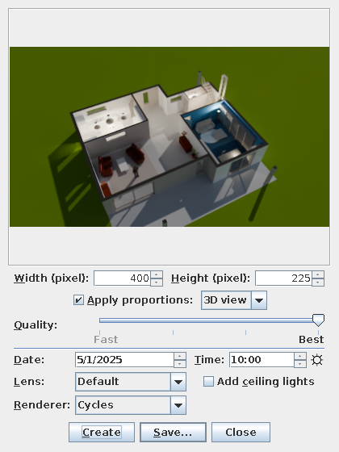
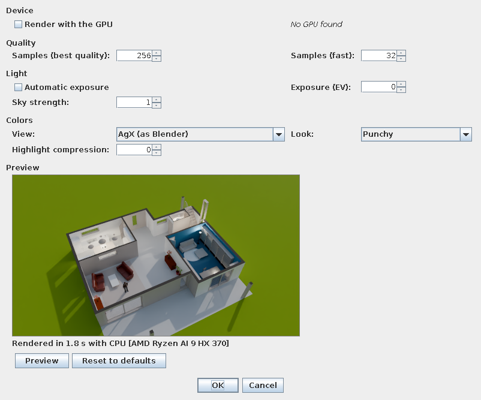

# Cycles Renderer Plugin for Sweet Home 3D

This project is a plugin for the [Sweet Home 3D](https://www.sweethome3d.com/)
interior design application. It adds [Cycles](https://www.cycles-renderer.org/),
Blender's path tracer, to the renderers of Sweet Home 3D's photo and video
dialogs, next to SunFlow and YafaRay.

*A floor by day: YafaRay at its best quality (left) and Cycles (right)*

*The same floor in the evening, with its lights on*

*A bedroom by day*

*The same bedroom in the evening, with its lights on*

## Features

* **A regular Sweet Home 3D renderer** - Cycles is listed in the *Renderer*
  combo box of the *Create photo*, *Create photos at points of view* and
  *Create 3D video* dialogs. Its progressive preview is updated a few times a
  second while rendering, and the *Stop* button works as with the other
  renderers
* **Usable by other plugins** - Any plugin creating renderers with Sweet Home
  3D's API can use it, e.g.
  `AbstractPhotoRenderer.createInstance("com.eteks.sweethome3d.j3d.CyclesRenderer", home, null, quality)`
* **Global illumination** - Light bounces around rooms, from the sun, the sky
  and every light source
* **Sweet Home 3D's sun, sky, lights and colors** - The sun, sky and lights of
  SunFlow and YafaRay, matching the date, time and location of the project,
  rendered with a fixed exposure and sRGB colors as they do. So the renders of
  a project are comparable, e.g. the images of each light of the
  [floor plan plugin](https://github.com/shmuelzon/home-assistant-floor-plan),
  or the frames of a video
* **Denoising** - With Intel's Open Image Denoise
* **Settings saved in the project** - *Tools > Cycles Renderer Settings...*
  chooses the GPU, the samples, the exposure, the sky's strength and the colors
  (Standard or Blender's AgX filmic view and their looks), with a preview. As
  they're saved in the project, they apply to every render of it, from Sweet
  Home 3D's dialogs or from other plugins
* **Optional photographic look** - Automatic exposure, AgX, which compresses
  bright lights softly toward white instead of clipping them, and a local
  compression of the highlights, so the outdoors can be seen through windows
* **Self-contained** - The plugin includes everything it needs, there's
  nothing else to install

## Installation

Download the plugin file for your platform from the
[releases](https://github.com/shmuelzon/sh3d-cycles-renderer/releases) (or from
the artifacts of a [CI](https://github.com/shmuelzon/sh3d-cycles-renderer/actions)
run) and double-click it: Sweet Home 3D offers to install it. Alternatively,
copy it to Sweet Home 3D's plugins directory (`~/.eteks/sweethome3d/plugins` on
Linux, `%APPDATA%\eTeks\Sweet Home 3D\plugins` on Windows,
`~/Library/Application Support/eTeks/Sweet Home 3D/plugins` on macOS) and
restart Sweet Home 3D.

| Platform | Plugin file |
|---|---|
| Linux (x86-64) | `CyclesRendererPlugin-<version>-linux-x64.sh3p` |
| Windows (x86-64) | `CyclesRendererPlugin-<version>-windows-x64.sh3p` |
| macOS (Apple Silicon) | `CyclesRendererPlugin-<version>-macos-arm64.sh3p` |
| All of the above | `CyclesRendererPlugin-<version>.sh3p` (larger) |

On first use, the plugin extracts its native renderer to Sweet Home 3D's cache
directory (`~/.cache/sweethome3d` on Linux, `%LOCALAPPDATA%\eTeks\Sweet Home
3D\cache` on Windows, `~/Library/Caches/eTeks/Sweet Home 3D` on macOS).

## Usage

In the *Create photo* dialog, move the *Quality* slider to one of its two
right-most positions and choose *Cycles* in the *Renderer* combo box. The
lower of the two positions renders up to 32 samples per pixel, the best one up
to 256.

*Tools > Cycles Renderer Settings...* sets the renderer's settings for the
project, saved with it:

| Setting | Default | Description |
|---|---|---|
| Render with the GPU | Off | Renders with the first GPU Cycles finds (Metal on macOS, HIP for AMD GPUs), or the CPU when there's none or it fails. See [Limitations](#limitations) |
| Samples (best quality / fast) | 256 / 32 | Maximum samples per pixel of the two right-most positions of the quality slider (adaptive sampling stops earlier where the image is clean) |
| Automatic exposure | Off | Adjusts the exposure of each image to its content, so the renders of a project aren't comparable anymore (e.g. the images of each light of the floor plan plugin, or the frames of a video) |
| Exposure | 0 | In stops: 0 is as bright as SunFlow and YafaRay, or a correction of the automatic exposure |
| Sky strength | 1 | The daylight sky's brightness, relative to YafaRay's |
| View | Standard | Standard: sRGB, clipped at 1, as SunFlow and YafaRay. AgX: Blender's filmic view |
| Look | None | The contrast of the view, as Blender's looks (e.g. Punchy or Medium High Contrast with AgX) |
| Highlight compression | 0 | Darkens bright areas, e.g. the outdoors seen through windows, depending on each image's content |

Java system properties, prefixed with `com.eteks.sweethome3d.j3d.CyclesRenderer.`
and given to Sweet Home 3D when it starts (e.g. `java
-Dcom.eteks.sweethome3d.j3d.CyclesRenderer.debug=true -jar SweetHome3D.jar`),
are for development:

| Property | Default | Description |
|---|---|---|
| `device` | `auto` | Cycles device used when rendering with the GPU: `auto`, `hip`, `metal`, `hip+cpu`... |
| `options` | | Extra options of the native renderer, overriding the settings (see [native/README.md](native/README.md#running)) |
| `executable` | | Path of another `sh3d-cycles` executable to use |
| `debug` | `false` | Print the native renderer's output and keep the exported scenes |

## How It Works

* The plugin defines its renderer classes in Sweet Home 3D's own class loader
  and package (`com.eteks.sweethome3d.j3d`), and adds `CyclesRenderer` to the
  `com.eteks.sweethome3d.j3d.rendererClassNames` system property that lists
  Sweet Home 3D's renderers
* `CyclesSceneExporter` exports the scene from the Java 3D objects of Sweet
  Home 3D, as its SunFlow and YafaRay renderers do: meshes, Sweet Home 3D's
  materials (colors, textures, shininess, transparency, mirrors and light
  sources), lights, sun and sky
* A native program, `sh3d-cycles` ([native/](native/)), linked with the Cycles
  libraries, renders the exported scene in its own process and sends
  progressive previews back

## Building

The build downloads its dependencies to `dl/`: Sweet Home 3D's jar, Cycles'
sources, the parts of Blender's precompiled libraries it needs (with
Git LFS) and Blender's color management configuration. Their versions are in
[versions.mk](versions.mk).

Requirements:

| Platform | Tools |
|---|---|
| Linux | `make`, `git`, `curl`, `unzip`, `patch`, CMake, Ninja, GCC or Clang, a JDK (8 or later) |
| macOS | Xcode command line tools, CMake, Ninja, a JDK (e.g. `brew install cmake ninja openjdk`) |
| Windows | Visual Studio 2022 (or its Build Tools) with C++, CMake, Ninja, Git for Windows (bash), GNU `make` and `unzip`, a JDK. Run `make` from Git Bash after setting up the Visual Studio environment (`vcvars64.bat`) |

`git-lfs` is used if installed, otherwise it's downloaded (Linux and macOS).

* `make` builds the plugin for the host platform: `CyclesRendererPlugin-<version>-<target>.sh3p`.
  The first build takes a while (about 10 minutes on 12 cores), later ones only
  rebuild what changed
* `make TARGET=<linux-x64|windows-x64|macos-arm64>` selects the target
  explicitly. Cross-compiling isn't supported, it has to match the host
* `make check` loads the plugin with Sweet Home 3D's plugin manager and renders
  a test room through Sweet Home 3D's renderer API. `PROJECT=<file.sh3d>`
  renders a project instead, and `POV="[<level>/]<point of view>"` one of its
  stored points of view. Renders are saved in `build/check/`
* `make install` installs the plugin to Sweet Home 3D's plugins directory, and
  `make test` also starts Sweet Home 3D (`PROJECT=<file.sh3d>` to open a project)
* `make universal` merges the per-target plugins of the current version in the
  current directory into one `CyclesRendererPlugin-<version>.sh3p`
* `make clean` removes the Java build and the plugin files, `make mrproper` the
  native build too, and `make distclean` the downloads as well
* `JOBS=<n>` sets the number of parallel compile jobs, `V=1` shows the commands

## Limitations

* **GPU rendering is untested** - Cycles is built with AMD HIP and Apple Metal
  support, but no precompiled GPU kernels are bundled. Metal compiles them from
  the bundled sources on first use. HIP does too, but only with AMD's HIP SDK
  installed, which provides its compiler. Compiling takes a few minutes, during
  which the image says so, with its progress with Metal. When the GPU fails, the
  image is rendered with the CPU
* **Tested in Sweet Home 3D on Linux only** - The Windows and macOS plugins are
  tested by rendering through Sweet Home 3D's renderer API on headless CI
  runners, not yet in Sweet Home 3D's dialogs
* **Lenses** - The fisheye and spherical lenses are rendered as a regular
  perspective view
* **Interiors** - As light bounces around rooms in Cycles, while SunFlow and
  YafaRay only render its direct light (adding an ambient light to the virtual
  visits), the interiors of the virtual visits are darker by day and brighter
  when lit by lamps than with YafaRay. `--exposure EV` or `--auto-exposure on`
  adjust them
* **Materials** - Sweet Home 3D's materials (a color or a texture, shininess and
  transparency) are mapped to Cycles' Principled BSDF. There are no roughness,
  metal or bump maps, and no material overrides
* **Batches** - Each photo starts the native renderer and loads the scene again,
  which takes 1 to 2 seconds
* **Size** - 63 MB (macOS) to 79 MB (Linux) per platform, mostly Open Image
  Denoise's neural network weights. The universal plugin is about 214 MB
* **Sweet Home 3D versions** - The plugin is built and tested with the Sweet
  Home 3D version in [versions.mk](versions.mk). As SH3D's renderers,
  `CyclesSceneExporter` uses package-private parts of Sweet Home 3D, so other
  versions work as long as they don't change

## License

The code in this repository is licensed under the [MIT license](LICENSE).

The plugin files built from it also include:

* Cycles (Apache-2.0) and the libraries it uses (Embree, Open Image Denoise,
  OpenImageIO, OpenColorIO, OpenEXR, oneTBB and others, under Apache-2.0, BSD
  and MIT licenses), with their license files in `native/<target>/license/`
* Blender's color management configuration (AgX), distributed as is with
  Blender's license file
